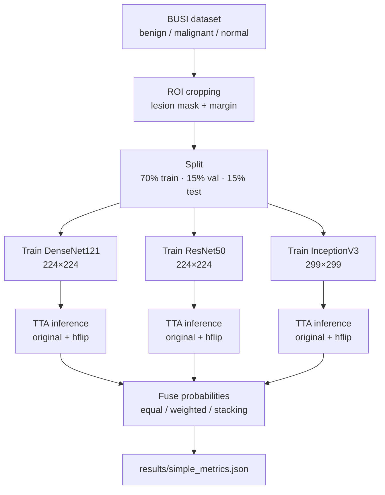

# Breast Cancer Ultrasound Classification — DenseNet121 / ResNet50 / InceptionV3 Fusion

Deep learning pipeline that classifies breast ultrasound images (BUSI dataset) into
**benign / malignant / normal** by combining three pretrained CNNs at the
probability level.

> **Scope:** academic ML experiment on a public dataset. Not a clinical diagnostic
> tool and has not undergone clinical validation.

---

## 1. What the pipeline does

---

## 2. How the fusion works

Each model outputs a probability per class. Fusion combines these three
probability sets in one of three ways:

| Strategy               | Rule                                            |
| ---------------------- | ----------------------------------------------- |
| **Equal-weight** | Average the 3 probabilities                     |
| **Weighted**     | Average with weights tuned on validation data   |
| **Stacking**     | Logistic regression learns the best combination |

---

## 3. Results

Metrics on the held-out test set (macro-averaged precision/recall/F1):

| Model                        | Accuracy         | Precision        | Recall           | F1-score         | Inference (ms/img) |
| ---------------------------- | ---------------- | ---------------- | ---------------- | ---------------- | ------------------ |
| DenseNet121                  | 0.7607           | 0.7450           | 0.8301           | 0.7604           | 1.390              |
| *ResNet50*                 | *0.8547*       | *0.8311*       | *0.8913*       | *0.8530*       | *1.282*          |
| InceptionV3                  | 0.5726           | 0.3501           | 0.5126           | 0.4091           | 1.469              |
| Fusion — equal weight       | 0.8632           | 0.8350           | 0.8964           | 0.8577           | 4.141              |
| Fusion — weighted           | 0.8632           | 0.8424           | 0.8964           | 0.8628           | 4.141              |
| **Fusion — stacking** | **0.8974** | **0.8768** | **0.9166** | **0.8939** | 4.141              |

**Key takeaways:**

- ResNet50 is the best single model; InceptionV3 is the weakest.
- Fusion always beats every individual model.
- **Stacking wins overall** (F1 = 0.894), at ~3× the inference cost.

---
